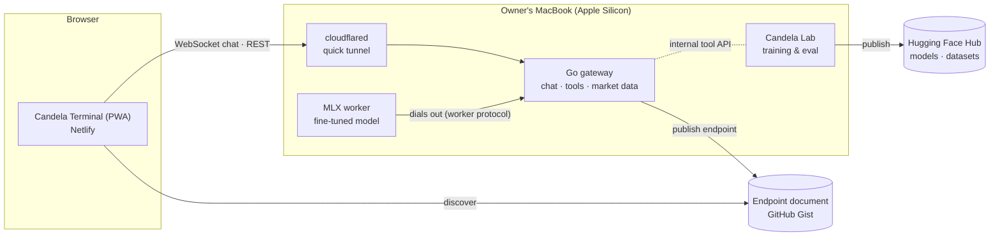

# Candela

**An open financial-analysis LLM, fine-tuned on a laptop, served by a Go gateway and explored through a terminal-style PWA with a 3D view of the model's internals.**

> Status: under active development. Live site: https://candela-terminal.netlify.app

Candela answers questions about US-listed stocks by calling deterministic tools for prices, technical indicators, fundamentals and forecasts, then writing a grounded, balanced analysis. Every number it states comes from a tool, with its date and source.

## Components

| Component | Stack | Role |
|---|---|---|
| **Candela Lab** (`ml/`) | Python 3.14, MLX, Hugging Face datasets | Data curation, synthetic tool-use traces generated through the production tool layer, resource-guarded LoRA fine-tuning on Apple Silicon, evaluation, export (MLX, GGUF), publishing |
| **Candela Worker** (`services/worker/`) | Python, MLX, FastAPI | GPU inference that dials out to the gateway, streams tokens and per-token interpretability telemetry, loads the model only on demand |
| **Candela Gateway** (`services/gateway/`) | Go 1.27, SQLite | Public API, WebSocket/SSE chat streaming, tool orchestration, market data, rate limiting, worker routing and queueing |
| **Candela Terminal** (`apps/web/`) | Angular 22 PWA, Tailwind CSS 4, Lightweight Charts, ECharts | Mobile-first, installable equity-research terminal |
| **Candela Observatory** (`apps/web/`) | three.js | 3D design view: live layer activity and logit lens, LoRA adaptation across checkpoints, embedding galaxy, training and eval dashboards |

## Architecture



When the Mac is offline the PWA plays real recorded sessions of the model. Design decisions are recorded in [`docs/adr`](docs/adr); shared interfaces live in [`contracts`](contracts).

## Repository layout

```
apps/web            Angular PWA (Terminal + Observatory)
services/gateway    Go API gateway
services/worker     Python MLX inference worker
ml                  Candela Lab (data, training, evaluation, export)
contracts           API, worker protocol, tool and artifact contracts
deploy              Live setup on the Mac, Netlify and Hugging Face assets
docs                Plans, ADRs, status reports, operations
```

## Local quality gates

There is no hosted CI. Each area exposes `make <area>-check`, and a versioned pre-commit hook blocks secrets, env files, model weights and oversized files. Run `make help` for every target.

## Not financial advice

Candela produces educational analysis from historical and statistical data. It does not provide investment advice.

## License

Apache-2.0. Model weights inherit the license of their base model.
